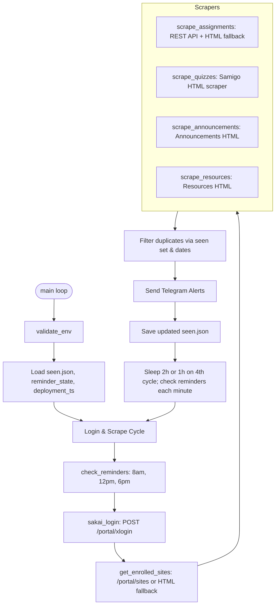

# Sakai LMS Assignment & Announcement Alerts — LLM Context & Specification

> **File:** `LLMS.md`  
> **Purpose:** Comprehensive architecture, design specification, and codebase reference for Large Language Models (LLMs) and autonomous AI coding agents interacting with or extending this project.

---

## 1. Project Overview

**Sakai-Assignment-Alerts** (also referenced as *AssignmentDey*) is an automated Python monitoring service for the University of Ghana's Sakai Learning Management System (`https://sakai.ug.edu.gh`).

The application runs as a persistent daemon/worker that:
1. Logs into Sakai using student credentials (`eid` & `pw`) and session cookies.
2. Discovers all enrolled course sites, optionally filtered by an active term code.
3. Scrapes assignments, quizzes, announcements, and uploaded course resources.
4. Filters out duplicate and outdated items using state files (`seen.json`, `deployment_ts.txt`).
5. Dispatches real-time Telegram alerts via the Telegram Bot API whenever new items are found.
6. Sends daily deadline reminder digests at scheduled hours (8:00 AM, 12:00 PM, 6:00 PM).

---

## 2. Directory Structure

```
Sakai-Assignment-Alerts/
├── monitor.py              # Monolithic entrypoint and core engine
├── requirements.txt        # Minimal Python dependencies (requests, bs4, python-dotenv)
├── Dockerfile              # Container definition (Python 3.12-slim, /data volume)
├── .dockerignore           # Excludes state files, cache, and git metadata
├── .gitignore              # Excludes secrets (.env) and persistent state files
├── README.md               # User-facing setup and hosting guide
├── reminder_state.json     # State tracking for daily reminder dispatch windows
└── LLMS.md                 # This LLM context and system specification file
```

### Runtime & Persistent Data Files (`DATA_DIR`):
When running locally or inside Docker/Coolify, state files are saved in `DATA_DIR` (defaults to current working directory `.` or `/data` in Docker):
- `seen.json`: Tracks seen IDs (`ids`) and full metadata objects (`items`) for pending assignments and quizzes.
- `reminder_state.json`: Maps reminder window names (`8am`, `12pm`, `6pm`) to `YYYY-MM-DD` strings to prevent duplicate reminder deliveries on the same day.
- `deployment_ts.txt`: Timestamp (ISO-8601) recorded on the very first run. Announcements and resources created before this timestamp are skipped to avoid alerting on historical semester items.

---

## 3. Technology Stack & Dependencies

- **Runtime:** Python >= 3.10 (Docker image uses `python:3.12-slim`).
- **HTTP Client:** `requests` (with persistent `requests.Session` for cookiejar retention).
- **HTML Parsing:** `beautifulsoup4` (`html.parser`).
- **Environment Management:** `python-dotenv` (`load_dotenv()`).
- **External APIs:**
  - Sakai LMS Portal & Direct REST API (`https://sakai.ug.edu.gh`).
  - Telegram Bot API (`https://api.telegram.org/bot<TOKEN>/sendMessage`).

---

## 4. Configuration & Environment Variables

Environment variables are loaded via `.env` or system environment:

| Variable | Required | Description | Default / Example |
|---|---|---|---|
| `SAKAI_USER` | **Yes** | Sakai student ID (EID) | `10XXXXXXX` |
| `SAKAI_PASS` | **Yes** | Sakai student account password | `secret_password` |
| `TELEGRAM_TOKEN` | **Yes** | HTTP API Bot token from Telegram `@BotFather` | `123456:ABC-DEF1234ghIkl-zyx57W2v1u123ew11` |
| `TELEGRAM_CHAT_ID` | **Yes** | Destination Telegram chat or user ID | `987654321` |
| `ACTIVE_TERM` | No | Substring filter matched against course titles | `S1-2526` or `2526` (empty = all sites) |
| `DATA_DIR` | No | Directory path for persistent JSON and state files | `.` (local) or `/data` (Docker volume) |

---

## 5. Architectural Flow & Key Subsystems



### 5.1 Authentication (`sakai_login`)
- **GET** `https://sakai.ug.edu.gh/portal` to obtain session cookies and extract any hidden `sakai_csrf_token`.
- **POST** `https://sakai.ug.edu.gh/portal/xlogin` with form payload:
  `{"eid": SAKAI_USER, "pw": SAKAI_PASS, "submit": "Login", "sakai_csrf_token": ...}`
- Verified by checking for `"logout"` in response HTML or `/portal/logout` in `resp.url`.

### 5.2 Course Discovery (`get_enrolled_sites`)
- First attempts direct JSON API: `GET /portal/sites` (parses `site_collection`).
- Fallback: Scrapes portal HTML for `a[href*='/portal/site/']`.
- Applies `ACTIVE_TERM` string filtering to eliminate stale or past semester courses.

### 5.3 Tool Scrapers & ID Generation Scheme
All items are assigned a canonical composite identifier to prevent collisions and duplicates:
- **Format:** `<type>::<site_id>::<normalized_title>`  
  *(where `normalized_title = title.lower().replace(" ", "_")`)*

1. **Assignments (`scrape_assignments`):**
   - Direct REST API endpoint: `/direct/assignment/site/{site_id}.json`.
   - Fallback: HTML table parsing at `/portal/site/{site_id}/tool-reset/sakai.assignment.grades`.
   - Filters out assignments whose due dates have already passed via `_is_future_or_unparseable`.
2. **Quizzes (`scrape_quizzes`):**
   - HTML table scraping at `/portal/site/{site_id}/tool-reset/sakai.samigo`.
   - Extracts title and due date.
3. **Announcements (`scrape_announcements`):**
   - Scrapes `/portal/site/{site_id}/tool-reset/sakai.announcements`.
   - Extracts subject and posted date; filters out announcements posted prior to `deployment_ts`.
4. **Resources (`scrape_resources`):**
   - Scrapes `/portal/site/{site_id}/tool-reset/sakai.resources`.
   - Filters out resources posted prior to `deployment_ts`.

### 5.4 Notification Engine & Telegram Formats
- Uses `https://api.telegram.org/bot<TOKEN>/sendMessage`.
- Note on parsing mode: Uses plain text (`parse_mode: ""` / omitted) rather than MarkdownV2 to guarantee deliveries are never rejected by unescaped punctuation in assignment titles or course names.
- Three notification types:
  - **New Tasks:** `New Assignment/Quiz Detected!` with Course, Title, Due date.
  - **Announcements:** `📢 New Announcement!` with Course, Title, Posted date.
  - **Resources:** `📁 New Resource Added!` with Course, Title, Added date.

### 5.5 Scheduled Reminders (`check_reminders`)
- Evaluates every minute during sleep intervals:
  - **8:00 AM:** Morning reminder (`Good morning!`).
  - **12:00 PM:** Midday reminder (`Good afternoon!`).
  - **6:00 PM (18:00):** Evening reminder (`Good afternoon!`).
- Compiles all non-expired assignments and quizzes from `seen.json` `items` list into a formatted task list with human-friendly due date badges (`Today`, `Tomorrow`, or full weekday format).
- Prevents multi-firing per window using `reminder_state.json`.

### 5.6 Scheduling & Polling Cycle
- **Normal Interval:** 7,200 seconds (2 hours).
- **Fast Interval:** 3,600 seconds (1 hour) on every 4th cycle (`login_count % 4 == 0`).
- Sleep is partitioned into 60-second steps:
  ```python
  for _ in range(interval // 60):
      time.sleep(60)
      check_reminders(stored_items)
  ```
  This ensures reminders trigger immediately on the scheduled hour rather than waiting for a 2-hour cycle to conclude.

---

## 6. Important Heuristics & Implementation Details

When making modifications or adding features, be aware of the following design decisions:

1. **Title Extraction (`_extract_title_from_row` & `_is_meaningful_title`):**
   - Sakai tables contain numeric row IDs, anchor tags with `#`, and `mailto:` links for instructors.
   - The extractor rejects links with `mailto:`, in-page anchors `#`, pure numeric strings, single characters, and text containing `@`.
2. **Date Parsing (`parse_due_date` & `_DATE_FORMATS`):**
   - Sakai instances render dates inconsistently across tools and locales (e.g. `Jan 15, 2026 11:59 PM`, `26 May 2026`, `26/05/2026`, `2026-05-26`).
   - `_DATE_FORMATS` maintains an ordered list of 10 format strings tried from most specific to least specific.
3. **Resilience & Fault Tolerance:**
   - Single cycle errors in `check_once` are wrapped in try-catch blocks and will not crash the long-running daemon.
   - HTTP requests enforce strict timeouts (`timeout=10` to `timeout=30`) and rate limiting (`REQUEST_DELAY = 1.0s`) to prevent getting IP-blocked or hanging on stale connections.
4. **Data Schema Migration:**
   - `load_seen()` handles both legacy flat-list formats (`["id1", "id2"]`) and modern dictionary schemas (`{"ids": [...], "items": [...]}`). Preserve this backwards compatibility.

---

## 7. Development & Testing Commands

### Local Execution:
```bash
# Activate virtual environment
python -m venv .venv
# Windows:
.venv\Scripts\activate
# Linux/macOS:
source .venv/bin/activate

# Install dependencies
pip install -r requirements.txt

# Run monitor
python monitor.py
```

### Docker Build & Run:
```bash
# Build Docker image
docker build -t sakai-assignment-alerts .

# Run with persistent volume for state
docker run -d \
  --name sakai-alerts \
  --env-file .env \
  -v sakai_data:/data \
  --restart unless-stopped \
  sakai-assignment-alerts
```

---

## 8. Guidance for LLM Agents Modifying this Codebase

- **Keep It Monolithic (unless requested otherwise):** `monitor.py` is intentionally lightweight and self-contained for simple single-file deployment to cloud providers (Render, Railway, Heroku, Coolify, VPS). Refactor into multiple modules only if the user explicitly asks for modularization.
- **Do Not Break Plain-Text Telegram Messages:** MarkdownV2 parsing in Telegram requires strict escaping for dozens of characters (like `_`, `*`, `[`, `]`, `(`, `)`, `~`, `` ` ``, `>`, `#`, `+`, `-`, `=`, `|`, `{`, `}`, `.`, `!`). Keep `parse_mode: ""` unless a dedicated escaping helper is added.
- **Preserve Persistent Volume Compatibility:** Any new persistent file must use `DATA_DIR / "filename"` so that containerized volume mounts retain the data across restarts.
- **Never Commit Secrets:** Do not hardcode student credentials or Telegram bot tokens. Always pull from `os.getenv()`.


---

## 9. WhatsApp Channel & The `outbox.jsonl` Contract

A Node/Baileys service in `../WhatsappBot/` broadcasts the same alerts to WhatsApp class groups
and runs a Gemini Flash group assistant. It is **additive**: Telegram behaviour is untouched.

### 9.1 Division of responsibility

`monitor.py` remains the only component that touches Sakai. It owns login, scraping, dedup,
the `ACTIVE_TERM` filter, `deployment_ts` filtering and the 8am/12pm/6pm windows. The Node
service owns delivery, group routing, admin commands and the assistant. **Never re-implement
scraping, dedup or scheduling on the Node side** — that was the single most important constraint
on this feature.

### 9.2 The bridge

The two processes communicate through one append-only file on the shared volume,
`DATA_DIR / "outbox.jsonl"`, one JSON object per line. Chosen over HTTP (which drops alerts
whenever Node is down) and over SQLite (a native dependency and writer-lock contention for a few
dozen records a day).

Record kinds:

```jsonc
// queued from send_telegram / send_telegram_announcement / send_telegram_resource
{"v":1,"kind":"alert","event_id":"alert:<item id>","queued_at":"...","item":{
  "id","type","title","course","due_date","posted_date","link"}}

// queued from send_reminder, one per window per day
{"v":1,"kind":"digest","event_id":"digest:<window>:<YYYY-MM-DD>","queued_at":"...",
 "window":"8am","greeting":"Good morning!","items":[{...,"due_label":"Tomorrow"}]}
```

Contract rules for anyone modifying this:

1. **`event_id` must stay stable and derived from existing identity** (the item's composite ID, or
   window + date). The Node reader keeps a set of delivered event IDs, and that is the only thing
   preventing duplicate WhatsApp messages after a crash or a Telegram retry.
2. **Queue before sending to Telegram.** `queue_outbox_items()` is called at the top of each
   sender so a Telegram outage never costs a WhatsApp broadcast.
3. **Never raise from the outbox helpers.** `_append_outbox` and `write_status` swallow their own
   errors; a full or read-only volume must not take down the scrape loop.
4. **Only append.** The reader tracks a byte offset. Rewriting or reordering lines will replay or
   skip messages. Rotation past `OUTBOX_MAX_BYTES` is the one exception, and the reader detects
   the resulting shrink.
5. New fields are additive. The Node side reads defensively, but bump `v` if a field's meaning
   changes.

### 9.3 Related additions to `monitor.py`

| Function | Purpose |
|---|---|
| `_item_link(item)` | Builds a Sakai deep link from the composite ID plus `_TOOL_PATHS`. No scraper changes were needed to add links. |
| `queue_outbox_items(items)` | Queues already-deduplicated new items. Called from all three Telegram senders. |
| `queue_outbox_digest(window, greeting, pending)` | Queues the digest from the same pending list Telegram renders. |
| `_pending_items(items)` | Extracted from `_build_reminder_message` so both channels compute "outstanding" identically. Telegram output is byte-identical to before. |
| `write_status(**fields)` | Heartbeat at `DATA_DIR / "scraper_status.json"`, consumed by the bot's `/status`. |

Note: `_pending_items` intentionally still includes announcements and resources (they have no due
date, so they appear as `Unknown`), preserving the existing Telegram digest exactly. The WhatsApp
side filters the digest down to `Assignment` and `Quiz` in `broadcaster.js`, because a deadline
summary full of `Unknown` rows is noise. Change that filter there, not here.

### 9.4 Standing constraints

- **No per-student Sakai credentials, ever.** One account (the owner's) scrapes course-level items
  shared with a whole class. Subscribers are identified by WhatsApp number alone. There is no
  per-user login and no student identity in any state file. This is deliberate, not an oversight.
- **The assistant is trigger-based**, replying only to an @mention, a reply, or `/ask`. Do not add
  an always-on path.
- **All automated sends stay throttled** with randomised delays, and ads exist only as a single
  sponsor line appended to a digest. No standalone ad broadcasts.
- **The bot runs on a dedicated second number**, never a personal one.
